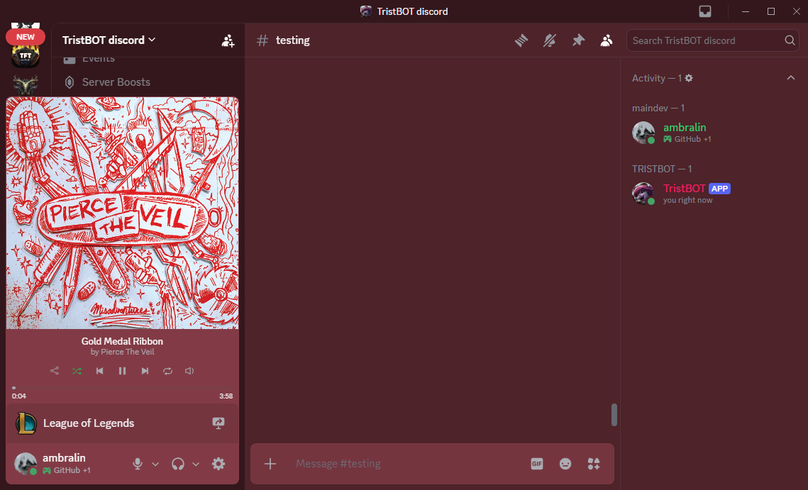
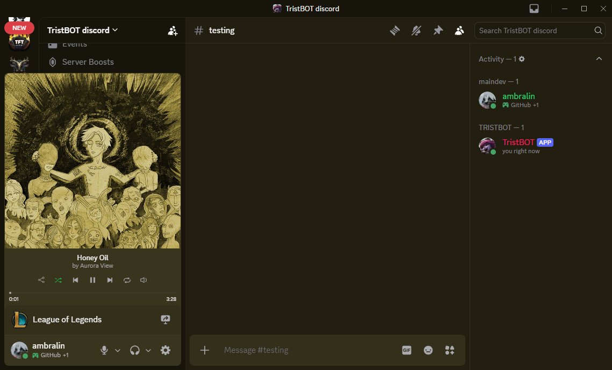
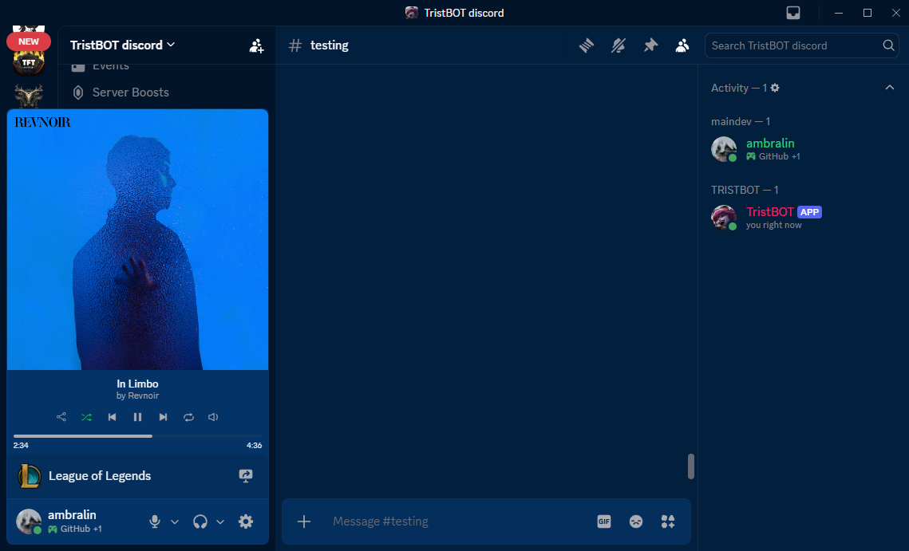

# MusicTheme for Vencord

A [Vencord](https://vencord.dev) port of [MusicTheme](https://github.com/Ambralin/MusicTheme_BD-Plugin) by **Ambralin & kaan**, originally a BetterDiscord plugin.

It reads your current music presence (Spotify or YouTube Music), picks the most vibrant color from the album art, and tints Discord's backgrounds to match. The color updates whenever the song changes, and the tint goes away when you stop playing.

> YouTube Music needs the [PreMiD](https://premid.app) browser extension so it shows up as a presence.
> It doesn't work alongside Nitro client themes.


<p align="center">
  
  
</p>

<sub>Screenshots are from the original BetterDiscord plugin by Ambralin. The Vencord port looks the same.</sub>

## Install

Custom plugins only work with a [Vencord source build](https://docs.vencord.dev/installing/custom-plugins/).

```sh
cd /path/to/Vencord
git clone https://github.com/apeirs/vencord-musictheme src/userplugins/musicTheme
pnpm build
pnpm inject   # only needed the first time
```

Restart Discord, then turn on **MusicTheme** in Settings → Vencord → Plugins.

## Changes from the original

- Uses Vencord's `definePlugin` and `flux` subscription in place of the `BdApi` Dispatcher and style helpers.
- Rewritten in TypeScript. Color extraction (k-means on the album art) and the generated CSS are the same as upstream v1.6.1.

## License

[CC BY-NC 4.0](LICENSE), the same license as the original. Free to use, not for resale.
Original work © Ambralin & kaan. Ported to Vencord by apeirs.
